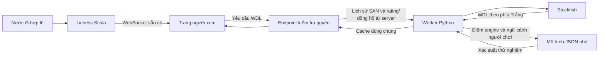

# Lichess WDL Lab

Fork Lichess tự host, bổ sung một thanh xác suất **Trắng thắng / Hòa / Đen thắng** cho người xem ván cờ tiêu chuẩn. Thanh ưu tiên mô hình người chơi có xét thế cờ, rating và đồng hồ; khi thiếu dữ liệu hoặc ngoài phạm vi, dùng WDL của engine. Nhãn ngắn bên dưới cho biết nguồn; không hiển thị hai bộ tỷ lệ hoặc tên/độ sâu engine.

Tiến độ và bằng chứng nằm trong [mốc engine](openspec/changes/live-win-probability/tasks.md) và [mốc mô hình người chơi](openspec/changes/human-win-probability/tasks.md). Phạm vi, kết quả và giới hạn mô hình được ghi trong [model card](reports/human-v1/model-card.md).

**Báo cáo nghiệm thu cuối bằng tiếng Việt:** [bao-cao-nghiem-thu.md](reports/acceptance/bao-cao-nghiem-thu.md), kèm log, JSON và ảnh được lưu trong `reports/acceptance/evidence/`.

**Cập nhật giao diện theo phản hồi:** [một thanh xác suất](reports/acceptance/ui-don-gian.md).

## Chạy trên máy này

Cần Docker Desktop chạy Linux containers, Git và PowerShell. Máy kiểm thử cấp khoảng 14 GiB RAM cho Docker; lần build đầu tải nhiều dependency của Lichess. `uv` và Node chỉ cần cho các lệnh kiểm thử ở máy host.

```powershell
# Lần đầu: lấy đúng source, áp patch, dựng UI/backend và database.
.\scripts\dev.ps1 bootstrap

# Khởi động / xem trạng thái / xem log.
.\scripts\dev.ps1 start
.\scripts\dev.ps1 status
.\scripts\dev.ps1 logs

# Dừng nhưng giữ database và cache.
.\scripts\dev.ps1 stop
```

Địa chỉ local: <http://localhost:8080>. Chỉ cổng `127.0.0.1:8080` được công bố; worker, MongoDB và Redis nằm trong mạng Docker. Cấu hình này phục vụ phát triển local.

`bootstrap` tạo bộ JAR bằng task `stage`. `start` chạy bộ JAR đó với heap tối đa 1 GiB và chờ trang chủ sẵn sàng; không giữ tiến trình sbt lúc chơi. Cache dependency và cache task sbt được lưu trong Docker volumes. Sau khi sửa Scala hoặc UI, chạy lại `bootstrap`, rồi `stop` và `start` để dùng bản mới.

Source đã ghim trong [upstream-lock.json](upstream-lock.json). Lichess nằm tại `infra/lila-docker/repos/lila`; các thay đổi cần lưu lại trong `patches/lila-win-probability.patch`. Script chuẩn bị Linux khôi phục symlink mà Git Windows checkout thành file văn bản. Các model LFS lớn của tính năng khác không được tải trong bootstrap này.

## Luồng dữ liệu



- Mỗi ván chỉ giữ thế cờ mới nhất trong hàng đợi. Nhiều người xem cùng thế cờ dùng chung kết quả.
- UI xóa số cũ ngay khi có nước đi mới và đối chiếu toàn bộ lịch sử, trạng thái và người thắng trước khi nhận phản hồi.
- Hoàn tác rồi đi nước khác ở cùng số ply không được dùng nhầm kết quả trước đó.
- Khi tua lại, UI ẩn WDL của thế cờ mới nhất. Khi mất kết nối, UI hiện trạng thái chờ đồng bộ.
- Kết quả chính thức của ván ghi đè đánh giá engine, kể cả khi worker lỗi. Ván hủy không được gán xác suất thắng/hòa.
- Tài khoản hoặc cookie của người đang chơi bị từ chối ở endpoint WDL. Worker không nhận FEN từ trình duyệt.
- Mô hình người chơi dùng chung lượt tính engine. Thiếu rating/đồng hồ, sai phạm vi hoặc model lỗi thì không hiện phần trăm người chơi. Ván ẩn danh vẫn có đánh giá engine.
- Prediction dùng hai worker, mỗi engine một thread và 64 MiB hash, trong container giới hạn 2 CPU/512 MiB. Yêu cầu lỗi thời bị loại kết quả; lượt tìm kiếm đã bắt đầu được kết thúc có giới hạn trước khi tái sử dụng engine để tránh race UCI.

Chi tiết quyết định và giới hạn: [design.md](openspec/changes/live-win-probability/design.md).

## Kiểm tra và nghiệm thu

```powershell
.\scripts\dev.ps1 check

# Thêm toàn bộ test Scala, test frontend và kiểm tra định dạng Scala.
.\scripts\dev.ps1 check -Full

# Kiểm thử trình duyệt dùng Playwright của chính Lichess.
.\scripts\dev.ps1 browser

# Kiểm tra thêm tình huống dừng rồi bật lại worker local.
.\scripts\dev.ps1 browser -WithOutage

# Tạo hai tài khoản local và nghiệm thu dòng dự đoán người chơi.
.\scripts\dev.ps1 browser -HumanPlayers -WithOutage
```

Lệnh `browser` mặc định tạo hai người chơi ẩn danh và một người xem trong ba phiên riêng, đi cờ, hoàn tác, tải lại trang và kiểm tra kết quả chính thức. `-HumanPlayers` đăng ký hai tài khoản chỉ trên máy local, dùng mailer mock; `-WithOutage` dừng rồi bật lại worker trong lúc ván đang chạy. Báo cáo JSON và ảnh chụp nằm trong `artifacts/`.

Đợt nghiệm thu cuối ngày 05/11/2026 đã qua **56 test Python, 264 test frontend, full build UI, định dạng và lint**. Backend Scala không đổi trong đợt rà soát này; build tích hợp trước đã qua, dùng cache test, còn mốc engine ban đầu đã chạy 603 test Scala. Browser có tài khoản đo p95 **554 ms** trên 20 lượt đi đầu; ván ẩn danh **561 ms**. Reconnect mạng, hoàn tác, tua lại, worker lỗi/phục hồi, chiếu hết, hòa, bỏ cuộc, hết giờ và hủy ván đều đã được thử. Worker riêng đo p95 **279 ms** trên 21 thế cờ; 100 yêu cầu trùng không tạo thêm lượt tính engine. Probe bốn ván/100 yêu cầu đo 587,1 ms cho vị trí cuối với hai worker, so với 1.061,2 ms với một worker; đây là một đợt tải có giới hạn, không phải benchmark capacity dài hạn. Xem [báo cáo nghiệm thu](reports/acceptance/bao-cao-nghiem-thu.md).

Để xem bằng tay, mở một ván cờ tiêu chuẩn đang chơi từ phiên trình duyệt thứ ba, độc lập với hai phiên người chơi. Panel nằm cạnh danh sách nước đi. Trang xem ván đang diễn ra có WDL; trang phân tích của ván đã kết thúc chưa được tích hợp ở giai đoạn này.

## Mô hình người chơi và tái lập

Model hiện tại là logistic regression đa lớp với 23 đặc trưng, kèm temperature calibration. Huấn luyện 8.000 ván tháng 8/2026, hiệu chỉnh 2.000 ván tháng 9, kiểm tra 2.000 ván tháng 10. Log loss **0,712218**, Brier **0,455070**, cải thiện khoảng 12,0% và 14,1% so với baseline tần suất kết quả. Dữ liệu là phần đầu các archive đã được phân tích, có thiên lệch chọn mẫu; chỉ 61 ván hòa trong tập kiểm tra. Không suy rộng các số này thành độ chính xác cho mọi người chơi.

Hỗ trợ thử nghiệm: standard blitz/rapid, hai rating 600–3000, ply 4–140, thời gian ban đầu 30–1800 giây và increment ≤60 giây. Dự đoán cập nhật theo nước đi, chưa cập nhật chỉ theo thời gian đồng hồ trôi. Chưa hiệu chỉnh cho cộng đồng máy chủ local hoặc riêng nhóm tài khoản mới.

```powershell
# Tải có giới hạn; dùng lại dữ liệu đã lưu nếu có manifest.
.\scripts\model.ps1 collect

# Tái lập vào artifacts/human-reproduction/, giữ nguyên model đang phục vụ.
.\scripts\model.ps1 train
```

Artifact phục vụ nằm ở `services/prediction/models/human-v1.json`; Docker image không chứa NumPy/sklearn. Thư viện huấn luyện được tách trong nhóm `ml` của uv. Xem [model card](reports/human-v1/model-card.md) để đọc provenance, checksum, baseline, hiệu chỉnh, đánh giá engine thực và giới hạn. Báo cáo cũng ghi rõ việc chạy lại tập tháng 10 sau sửa lỗi lấy mẫu chỉ chọn ply chẵn.

Các file chính để đọc:

| Phần | Vị trí |
|---|---|
| Hợp đồng đầu vào, lịch sử thế cờ và kết quả ván | `services/prediction/app/models.py` |
| Chuyển WDL về góc nhìn Trắng | `services/prediction/app/engine.py` |
| Hàng đợi, hủy việc cũ, cache và phục hồi | `services/prediction/app/scheduler.py` |
| Đặc trưng dùng chung và suy luận model JSON | `services/prediction/app/human.py` |
| Lấy mẫu, huấn luyện, hiệu chỉnh và đánh giá | `services/prediction/training/` |
| Kết quả và giới hạn mô hình | `reports/human-v1/model-card.md` |
| Endpoint và kiểm tra người xem | `infra/lila-docker/repos/lila/app/controllers/Round.scala` |
| Gọi worker, cache HTTP và kết quả chính thức | `infra/lila-docker/repos/lila/app/http/WinProbability.scala` |
| Đồng bộ UI và loại phản hồi cũ | `infra/lila-docker/repos/lila/ui/round/src/winProbability.ts` |
| Các tiêu chí nghiệm thu | `openspec/changes/live-win-probability/specs/win-probability/spec.md` |

## Quy trình AI của project

`AGENTS.md` ghi quy tắc làm việc và các điều kiện đúng của bài toán. Thư mục `openspec/` sử dụng cấu trúc đặc tả OpenSpec; không cần chạy thêm một agent framework để vận hành ứng dụng.

Ba skill từ [Superpowers](https://github.com/obra/superpowers) được cài ở `.agents/skills/`: `systematic-debugging`, `test-driven-development`, `verification-before-completion`. Nguồn và commit nằm trong [workflow-lock.json](workflow-lock.json), giấy phép MIT được giữ kèm. Chỉ đọc skill và mã nguồn liên quan đến bước đang làm; ghi trạng thái ngắn vào task list để tiếp tục mà không phải đọc lại toàn bộ context.

Code và bài kiểm thử của tính năng này được hỗ trợ bởi Codex. Người dùng đọc, chạy thử và nghiệm thu bản fork local; chưa gửi đóng góp lên upstream.
