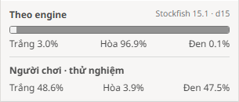
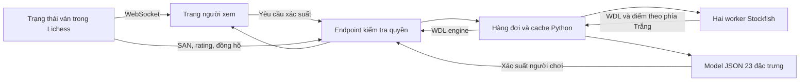
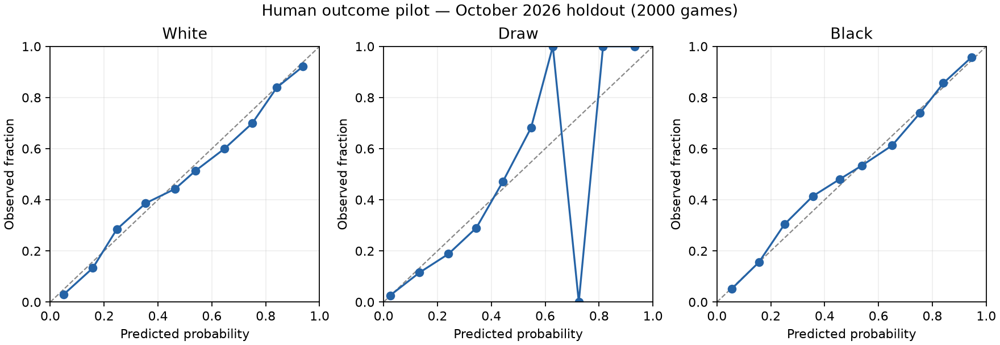

# Báo cáo triển khai và nghiệm thu Lichess WDL Lab

> Cập nhật sau nghiệm thu: giao diện đã được rút gọn thành **một thanh, một bộ tỷ lệ**
> theo phản hồi của người dùng. Xem [phụ lục giao diện mới](ui-don-gian.md).
> Ảnh và số liệu bên dưới lưu lại đợt nghiệm thu trước thay đổi giao diện.

**Ngày:** 05/11/2026 — múi giờ Việt Nam.  
**Phạm vi kết luận:** bản thử nghiệm chạy local tại <http://localhost:8080>.  
**Model:** `human-logit-v1-54213e4fef50`.  
**Trạng thái:** đạt các tiêu chí nghiệm thu trong phạm vi bên dưới.

## 1. Kết quả bàn giao

Hệ thống đã tích hợp hai loại dự đoán Trắng thắng / Hòa / Đen thắng vào trang người xem
của bản Lichess tự host. Dòng **“Theo engine”** lấy WDL từ Stockfish. Dòng
**“Người chơi · thử nghiệm”** dùng thêm rating và đồng hồ để ước lượng kết quả ván người chơi.
Hai dòng có nhãn riêng vì chúng mô tả hai cơ chế dự đoán khác nhau.

Đợt nghiệm thu cuối chạy lại toàn bộ 56 test Python và 264 test frontend, kiểm tra kiểu,
lint, định dạng, build UI, HTTP với Stockfish thật và các luồng trình duyệt. Hai lỗi được
tái hiện và sửa: đồng bộ socket thừa khi mở trang, và race khi hủy yêu cầu trong lúc
bắt tay UCI. Thử tải có giới hạn dẫn đến lựa chọn hai worker, trong mức 2 CPU/512 MiB
đã cấu hình cho dịch vụ prediction.



Các phần trăm trong ảnh là một quan sát của một thế cờ, không phải số đo độ chính xác
của mô hình. Mỗi dòng cộng đủ 100,0%. Giao diện mobile đã được xem lại qua
[ảnh chụp ở kích thước 390 × 844](evidence/mobile.png).

## 2. Kiến trúc và điều kiện hoạt động



Trình duyệt không tự cung cấp FEN, rating hoặc đồng hồ cho endpoint công khai. Scala đọc
trạng thái ván có thẩm quyền rồi gửi lịch sử SAN và ngữ cảnh sang worker nội bộ. Engine
nhận đủ lịch sử nước đi để giữ thông tin lặp thế cờ. Cache phân biệt game, lịch sử đầy đủ
và kết quả chính thức; không dùng riêng số ply làm định danh.

UI xóa dự đoán cũ sau nước đi mới, bỏ phản hồi thuộc revision khác, ẩn xác suất trực tiếp
khi tua lại và chuyển sang trạng thái chờ đồng bộ khi mất kết nối. Kết quả chính thức
ghi đè cả hai loại dự đoán. Ván hủy không được gán người thắng hay xác suất hòa giả.

| Thuộc tính | Cấu hình/điều kiện đã triển khai |
|---|---|
| Đối tượng xem | Spectator; endpoint từ chối phiên người đang chơi |
| Cổng công bố | Chỉ `127.0.0.1:8080`; worker và database không có host port |
| Engine | Stockfish 15.1, hai worker, một thread/engine, hash 64 MiB/engine |
| Ngân sách tìm kiếm | 250 ms/thế cờ; có timeout và phục hồi lỗi |
| Hàng đợi/cache | Tối đa 64 ván chờ, 512 kết quả cache; TTL thông thường 300 giây |
| Giới hạn container prediction | 2 CPU, 512 MiB |
| Model người chơi | Standard blitz/rapid; rating hai bên 600–3000; ply 4–140 |
| Thời gian hỗ trợ | Ban đầu 30–1800 giây, increment tối đa 60 giây; phải có đủ hai đồng hồ |
| Thiếu ngữ cảnh | Không tự gán rating; giữ dòng engine, thông báo thiếu dữ liệu người chơi |

Rating và đồng hồ chỉ tác động bước suy luận model; thay ngữ cảnh không tạo thêm lượt
tính engine cho cùng lịch sử. File model JSON có kích thước 9.368 byte. Thư viện huấn luyện
nằm trong nhóm `ml` của uv; image phục vụ không cần NumPy/sklearn. Luồng dự đoán này không
gọi API LLM cho từng nước đi.

Source và phiên bản runtime được ghim trong [upstream-lock.json](../../upstream-lock.json).
Bản Lichess gốc là commit `4eea97abce686a1cc6b07abe54cce9e10c223227`; thay đổi được lưu
trong [patch tái lập](../../patches/lila-win-probability.patch).

## 3. Dữ liệu, mô hình và kết quả đánh giá

Dữ liệu lấy từ archive ván chuẩn của Lichess, được công bố theo CC0. Bộ lấy mẫu đọc một
phần đầu archive có giới hạn dung lượng, giữ ván hoàn chỉnh có đánh giá engine và thông
tin cần thiết. Nguồn và điều khoản dữ liệu được xác minh tại
[Lichess Open Database](https://database.lichess.org/#standard_games).

| Vai trò | Tháng | Số ván | Số thế cờ |
|---|---|---:|---:|
| Huấn luyện | 08/2026 | 8.000 | 37.997 |
| Hiệu chỉnh temperature | 09/2026 | 2.000 | 9.412 |
| Đánh giá | 10/2026 | 2.000 | 9.341 |

Các tập không trùng game ID và phải theo thứ tự thời gian. Mỗi ván có tổng trọng số như
nhau dù số thế cờ được chọn khác nhau. Nhãn kết quả, rating sau ván, tên người chơi và
thông tin tương lai không được đưa vào vector đặc trưng. Model dùng logistic regression
đa lớp với 23 đặc trưng, hệ số regularization C=1 cố định và một temperature được chọn
trên tháng 9. Bộ trích xuất đặc trưng dùng chung cho huấn luyện và phục vụ.

| Phương án trên tập tháng 10 | Log loss | Brier đa lớp | Top-label ECE |
|---|---:|---:|---:|
| Model người chơi có temperature | 0,712218 | 0,455070 | 0,021899 |
| Logistic trước temperature | 0,712142 | 0,455004 | 0,021337 |
| Tần suất kết quả trong tập train | 0,809178 | 0,529755 | 0,017375 |
| Heuristic chỉ dùng rating | 0,827775 | 0,535523 | 0,061436 |
| Điểm PGN → công thức WDL SF15.1 | 6,974149 | 1,178645 | 0,587609 |

Log loss đo mức phạt đối với xác suất gán cho kết quả thực tế. Brier ở đây là tổng bình
phương sai số của ba lớp, có miền 0–2. Hai chỉ số đều ưu tiên giá trị thấp. ECE sử dụng
10 khoảng xác suất của lớp được dự đoán cao nhất; chỉ số này không tự chứng minh riêng
xác suất hòa đã được hiệu chỉnh tốt. Tài liệu
[scikit-learn về calibration](https://scikit-learn.org/stable/modules/calibration.html)
cũng phân biệt việc giảm loss với việc chứng minh calibration tốt hơn.

So với baseline tần suất, model giảm khoảng 12,0% log loss và 14,1% Brier. Chênh lệch
log loss là −0,09696, với khoảng bootstrap theo ván 95% [−0,10717; −0,08632], 500 lần
lấy mẫu. Các tiêu chí pilot được đặt trước lần fit đầu đều đạt. Các baseline này đơn giản;
kết quả chưa phải so sánh với một mô hình cây hoặc neural model đã được tuning.

Temperature giảm nhẹ loss tháng 9 nhưng làm ba chỉ số tháng 10 xấu đi một chút so với
logistic gốc. Quy trình đã chọn trước được giữ nguyên, không đổi phương án dựa trên kết
quả tập test. Baseline tần suất cũng có ECE thấp hơn model dù loss/Brier kém hơn.



Tập đánh giá gồm 970 ván Trắng thắng, 61 ván hòa và 969 ván Đen thắng. Những điểm ở vùng
xác suất hòa cao có ít dữ liệu nên đường reliability dao động; không kết luận model đã
hiệu chỉnh tốt cho hòa. Các lát cắt rating/nhịp độ, số mẫu và số liệu đầy đủ nằm trong
[evaluation.json](../human-v1/evaluation.json).

Một kiểm tra trước đó dùng Stockfish thật 250 ms trên 100 ván đánh giá cho kết quả hợp lệ
ở cả 100 vị trí. Thay điểm PGN bằng điểm mới làm thay đổi xác suất lớn nhất của mỗi vị trí
trung bình 2,12 điểm phần trăm, tối đa 32,19 điểm. Kiểm tra này chỉ là chẩn đoán chuyển
nguồn điểm engine, không chứng minh calibration khi triển khai. Xem
[engine-transfer.json](../human-v1/engine-transfer.json).

## 4. Những vấn đề đã tìm và sửa trong đợt rà soát cuối

### 4.1. Mất mạng khi trang vừa kết nối socket

Kịch bản browser tải lại trang người xem rồi chuyển sang offline đã gây điều hướng đến
trang lỗi mạng. Nguyên nhân là callback `socket.open` luôn yêu cầu tải lại trạng thái ván,
kể cả lần kết nối đầu tiên, trong khi dữ liệu trang vừa nhận đã có thẩm quyền. Khi yêu
cầu thừa này lỗi, fallback của Round socket tải lại toàn trang.

Callback hiện chỉ đồng bộ lại khi panel đang ở trạng thái `stale` sau một lần mất kết nối.
Browser kiểm tra rằng số cũ biến mất, dữ liệu được khôi phục và bộ đếm điều hướng toàn
trang vẫn bằng 0. Bằng chứng trước sửa ở [network-regression-before.log](evidence/network-regression-before.log),
sau sửa ở [browser-registered.json](evidence/browser-registered.json).

Trong quá trình kiểm tra, build riêng `round` tạo bundle nhưng không cập nhật asset
manifest theo quy tắc upstream. Vì vậy đã dùng full UI build, đồng thời thêm kiểm tra
HTML phải tham chiếu đúng bundle trong manifest. Bản nghiệm thu dùng `round.X2T6IZS5.js`.
Đây là sửa quy trình kiểm tra để tránh thử nhầm tài nguyên cũ.

### 4.2. Race khi hủy lúc Stockfish bắt tay UCI

Kịch bản làm đầy hàng đợi rồi hủy các ván đã phát hiện `InvalidStateError` và trạng thái
UCI `CommandState.NEW` không hợp lệ. Hủy coroutine trong lúc chờ `readyok` đã hủy Future
mà python-chess vẫn sử dụng khi xử lý phản hồi đến muộn.

Bài regression mới sử dụng parser `UciProtocol` thật với transport kiểm soát thời điểm
trả lời, tái hiện được lỗi trước sửa. Worker hiện bảo vệ tác vụ giao tiếp UCI khỏi hủy
giữa chừng, loại kết quả đã lỗi thời và chờ lượt tìm kiếm có giới hạn kết thúc trước khi
dùng lại engine. Scheduler không gửi lặp lệnh cancel vào một task đang xử lý hủy. Kết quả
chính thức vẫn được trả ngay ở đường xử lý riêng.

Đánh đổi là engine có thể hoàn tất phần còn lại của lượt tìm kiếm 250 ms đã bắt đầu;
kết quả đó không được dùng làm dự đoán mới. Khi quá timeout, tiến trình engine được đóng.
[Bài regression](../../services/prediction/tests/test_engine_cancellation.py) bắt lỗi ở
[log trước sửa](evidence/uci-regression-before.log), rồi qua trong suite cuối. Probe tải
thật với cả một và hai worker sau sửa đều kết thúc với `errors=0`.

## 5. Bằng chứng nghiệm thu và hiệu năng

| Hạng mục | Kết quả | Bằng chứng |
|---|---|---|
| Python | 56/56 test qua; lint qua | [python.log](evidence/python.log) |
| Frontend | 264/264 test qua, không skip | [frontend-tests.log](evidence/frontend-tests.log) |
| Build UI | Full build và manifest thành công | [frontend-build.log](evidence/frontend-build.log) |
| Type-aware lint, định dạng, CSS | Qua | [frontend-lint.log](evidence/frontend-lint.log) |
| Browser có tài khoản | 90 assertion qua | [browser-registered.json](evidence/browser-registered.json) |
| Browser ẩn danh | 91 assertion qua | [browser-anonymous.json](evidence/browser-anonymous.json) |
| HTTP worker thật | 21 thế cờ; WDL và model hợp lệ | [worker-http.log](evidence/worker-http.log) |
| Patch | Áp được vào HEAD ghim và kiểm tra reverse được trên checkout hiện tại | [provenance.json](evidence/provenance.json) |
| Dữ liệu/model | SHA256 khớp manifest; giữ nguyên model trong đợt rà soát | [provenance.json](evidence/provenance.json) |
| Trạng thái bàn giao | HTTP 200; worker healthy, model đã nạp, không có lỗi hoặc tác vụ tồn | [final-health.json](evidence/final-health.json) |

Các luồng browser bao gồm chặn người đang chơi ở endpoint, tổng phần trăm, nhãn theo phía
Trắng/Đen, lật bàn, tua lại, tải trang, mất mạng/kết nối lại, hoàn tác, thay nước đi cùng
ply và hiển thị mobile. Luồng có tài khoản còn dừng/bật lại prediction worker trong lúc
ván vẫn nhận nước đi. Chiếu hết, hòa, bỏ cuộc và hủy ván được thử trong cả hai chế độ;
hết giờ được thử bằng ván 15 giây ở chế độ ẩn danh. Không ghi nhận browser exception.

Không có thay đổi Scala trong đợt rà soát cuối. Mốc triển khai trước đã chạy 603 test
Scala; lần build tích hợp tiếp theo qua `scalafmtCheckAll;test;stage` và dùng cache test
thành công. Báo cáo này không tính 603 test đó như một lần chạy mới. Bằng chứng lịch sử
được phân biệt trong [task list](../../openspec/changes/human-win-probability/tasks.md).

| Phép đo | Kết quả |
|---|---:|
| Browser có tài khoản: từ thao tác nước đi đến WDL ready, p95 | 554 ms |
| Browser ẩn danh: cùng phép đo, p95 | 561 ms |
| HTTP worker, 21 thế cờ, polling 50 ms, p95 | 279 ms |
| 100 yêu cầu trùng sau khi có cache | 0 lượt tính engine bổ sung |
| Bốn ván, một worker: thời gian ready của vị trí cuối | 1.061,2 ms |
| Bốn ván, hai worker: thời gian ready của vị trí cuối | 587,1 ms |

Hai số browser p95 dùng 20 lượt đi đầu tiên; mảng latency trong JSON còn có hai lượt sau
hoàn tác, không thuộc phép tính p95 này. Đây là số đo trên máy local, có tiến trình kiểm
tra frontend trong môi trường; không phải benchmark chuẩn hóa giữa nhiều máy.

Probe bốn ván chạy trong container riêng, đã warm engine, gửi 100 yêu cầu bằng 20 thread
rồi polling theo ván mỗi 50 ms. Cả hai cấu hình chỉ thực hiện bốn lượt đánh giá cho bốn
vị trí. Hai worker giảm thời gian ready cuối đợt khoảng 44,7% trong quan sát này. Vì chỉ
có bốn vị trí, p95 theo nearest-rank trùng với giá trị lớn nhất; đây không phải 100 mẫu
latency độc lập và cũng không chứng minh sức tải ổn định dài hạn.

Probe tiếp tục gửi 96 ván để gây đầy hàng đợi: cấu hình một worker trả 31 phản hồi `busy`,
hai worker trả 30. Hàng đợi không vượt 64, số đang xử lý không vượt số worker. Cả 96 kết
quả hủy được trả về, hàng đợi được dọn hết và bộ đếm lỗi engine/model bằng 0. Số liệu ở
[một worker](evidence/load-workers-1.json) và [hai worker](evidence/load-workers-2.json).
Container phục vụ đo được 168,7 MiB/512 MiB sau luồng kiểm tra tuần tự; đây là ảnh chụp
tài nguyên tại một thời điểm, không phải đỉnh bộ nhớ của phép thử tải.

## 6. Giới hạn và điều kiện dừng

1. Dữ liệu là phần đầu của các archive có phân tích, tập trung vào những phút đầu ngày
   đầu tháng. Đây là chọn mẫu có thiên lệch, không đại diện toàn bộ tháng hoặc người chơi
   trên máy chủ riêng.
2. Tập tháng 10 đã được xem kết quả trước khi sửa bộ lấy mẫu chỉ chọn ply chẵn, rồi được
   đánh giá lại với cả hai bên đến lượt. Không gọi đây là holdout chưa từng được xem.
   Đợt rà soát cuối không tuning hoặc huấn luyện lại model trên tập test này.
3. Dữ liệu train là ván rated; browser dùng ván casual và tài khoản có rating ban đầu
   còn provisional. Chưa có bằng chứng calibration riêng cho các nhóm đó.
4. Dự đoán cập nhật theo nước đi và reconnect, chưa cập nhật chỉ vì đồng hồ trôi. Chưa
   tích hợp panel vào trang phân tích sau khi ván kết thúc; kết quả chính thức đã được
   kiểm tra trong phiên round đang mở.
5. Chưa thực hiện thử tải dài hạn, nhiều máy, hoặc triển khai công khai. Probe có giới
   hạn ở trên bổ sung bằng chứng về queue/cancel, không thay thế đánh giá capacity.
6. Suite Python còn một cảnh báo deprecation Starlette/httpx; một số test upstream Node
   ghi thông báo không có indexedDB. Không có test thất bại do các cảnh báo này.

Điều kiện dừng của đợt này là các tiêu chí pilot và kiểm tra bổ sung đã qua, lỗi đã tái
hiện được có regression/bằng chứng sau sửa, patch và artifact khớp nguồn, đồng thời các
giới hạn được ghi rõ. Không có lỗi nghiệm thu còn mở trong phạm vi này. Việc chọn mẫu
đại diện và hiệu chỉnh cho cộng đồng local thuộc một thí nghiệm tiếp theo cần dữ liệu
và một khoảng thời gian đánh giá mới chưa sử dụng.

## 7. Tái lập và các file cần đọc

Từ thư mục project, các lệnh sau tái lập kiểm tra; người dùng không cần chạy lại để hoàn
tất đợt bàn giao này:

```powershell
.\scripts\dev.ps1 start
.\scripts\dev.ps1 check -Full
.\scripts\dev.ps1 browser -HumanPlayers -WithOutage
.\scripts\dev.ps1 browser
.\scripts\model.ps1 train
```

`check -Full` chạy cả suite Scala và toàn bộ frontend; bỏ `-Full` để kiểm tra tập trung
vào tính năng. `-WithOutage` dừng/bật worker local để kiểm tra phục hồi. `model.ps1 train` ghi kết quả
vào `artifacts/human-reproduction/`, giữ nguyên artifact đang phục vụ. Dữ liệu và cache
build được giữ local và bỏ qua bởi Git; báo cáo này lưu bản sao log/JSON/ảnh cần đọc trong
`reports/acceptance/evidence/`. SHA256 trong provenance gắn các kết quả với bản nguồn cuối.

| Nội dung | File |
|---|---|
| Engine và hủy UCI an toàn | [engine.py](../../services/prediction/app/engine.py) |
| Hàng đợi, cache, chính sách hủy | [scheduler.py](../../services/prediction/app/scheduler.py) |
| Đặc trưng và suy luận JSON | [human.py](../../services/prediction/app/human.py) |
| Chi tiết đánh giá mô hình | [model-card.md](../human-v1/model-card.md) |
| Kịch bản nghiệm thu browser | [browser-smoke.mjs](../../scripts/browser-smoke.mjs) |
| Probe tải HTTP thật | [probe_worker_load.py](../../scripts/probe_worker_load.py) |
| Cấu hình local | [compose.yml](../../infra/compose.yml) |
| Theo dõi đợt rà soát | [final-audit.md](../../openspec/changes/human-win-probability/final-audit.md) |

Code, kiểm thử và báo cáo được thực hiện với Codex. Quy trình sử dụng ba skill Superpowers
`test-driven-development`, `systematic-debugging`, `verification-before-completion`, ghim
commit trong [workflow-lock.json](../../workflow-lock.json). Các phiên browser trong báo
cáo do tự động hóa thực hiện; không được mô tả là kiểm thử thủ công của người dùng.
