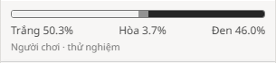

# Cập nhật thanh xác suất — 05/11/2026

Theo phản hồi của người dùng, giao diện chỉ còn **một thanh Trắng / Hòa / Đen và một bộ
ba tỷ lệ**. Đã bỏ dòng “Theo engine”, tên Stockfish và độ sâu tìm kiếm. Hai bộ xác suất
không bị lấy trung bình hay trộn với nhau.

Khi đủ dữ liệu và nằm trong phạm vi hỗ trợ, thanh dùng dự đoán người chơi với nhãn nhỏ
“Người chơi · thử nghiệm”. Khi thiếu dữ liệu, thanh dùng WDL engine với nhãn “Ước tính
từ thế cờ”; mô tả khi rê chuột giải thích nguồn. Kết quả chính thức luôn được ưu tiên.
Khi tua lại, mất kết nối hoặc đang chờ đánh giá, các số cũ được ẩn.

Mô hình, dữ liệu, endpoint và backend không thay đổi. Giới hạn calibration vẫn như
[model card](../human-v1/model-card.md). Các con số trong ảnh minh họa giao diện, không
phải độ chính xác của mô hình.

| Kiểm tra đã chạy | Kết quả | Bằng chứng |
|---|---|---|
| Kiểm thử trước sửa | 4 ca thất bại đúng hành vi cần đổi | [log](simple-panel/regression-before.log) |
| Suite round | 20/20 qua | [log](simple-panel/focused-tests.log) |
| Toàn bộ frontend | 265/265 qua, 0 fail/skip | [log](simple-panel/frontend-tests.log) |
| Full UI build | Qua, tạo manifest mới | [log](simple-panel/build.log) |
| Type-aware lint, format, stylelint | Qua | [log](simple-panel/lint.log) |
| Browser có tài khoản | 95 assertion, 0 exception | [JSON](simple-panel/browser-registered.json) |
| Browser ẩn danh | 115 assertion, 0 exception | [JSON](simple-panel/browser-anonymous.json) |
| Patch và model | 13 file áp thuận/ngược được; SHA256 model giữ nguyên | [JSON](simple-panel/provenance.json) |
| Demo local | HTTP 200, đúng bundle, dự đoán ready | [JSON](simple-panel/demo-health.json) |

Browser đối chiếu số hiển thị với nguồn được chọn, thử lật bàn, replay, reconnect, hoàn
tác, thay nước đi cùng ply, mobile và các kết quả chính thức. Luồng có tài khoản còn thử
worker dừng/phục hồi. Bản được phục vụ là `round.GFD3AYWC.js`. p95 trên 20 nước nửa lượt
đầu đo được 498 ms khi có tài khoản, 494 ms khi ẩn danh; đây là quan sát local trong lúc
suite frontend đang chạy, không phải so sánh benchmark với đợt trước.

Ảnh mobile [390 × 844](simple-panel/mobile.png) đã được xem lại, không tràn ngang.
Suite upstream vẫn ghi một số thông báo thiếu indexedDB trong môi trường Node; không
có test thất bại. Không chạy lại suite Python/Scala vì đợt này chỉ đổi phần trình bày UI.

Các file chính: [view](../../infra/lila-docker/repos/lila/ui/round/src/view/winProbability.ts),
[CSS](../../infra/lila-docker/repos/lila/ui/round/css/_win-probability.scss),
[test view](../../infra/lila-docker/repos/lila/ui/round/tests/winProbabilityView.test.ts),
[browser acceptance](../../scripts/browser-smoke.mjs),
[patch](../../patches/lila-win-probability.patch).

Ván demo 20+5: [g54Kmpdg](http://localhost:8080/game/g54Kmpdg/white), đã đi 10 nước mỗi bên.
Lệnh mở trong khung Codex đã được gửi; ảnh render thực tế ở [demo.png](simple-panel/demo.png).
Đây là ván có đồng hồ, sẽ hết giờ tự nhiên. Tải lại trang để dùng UI mới.

Để chạy lại kiểm tra tính năng: `./scripts/dev.ps1 check` và
`./scripts/dev.ps1 browser -HumanPlayers -WithOutage`. Công việc do Codex thực hiện trong
bản fork local, chưa gửi đóng góp upstream.
